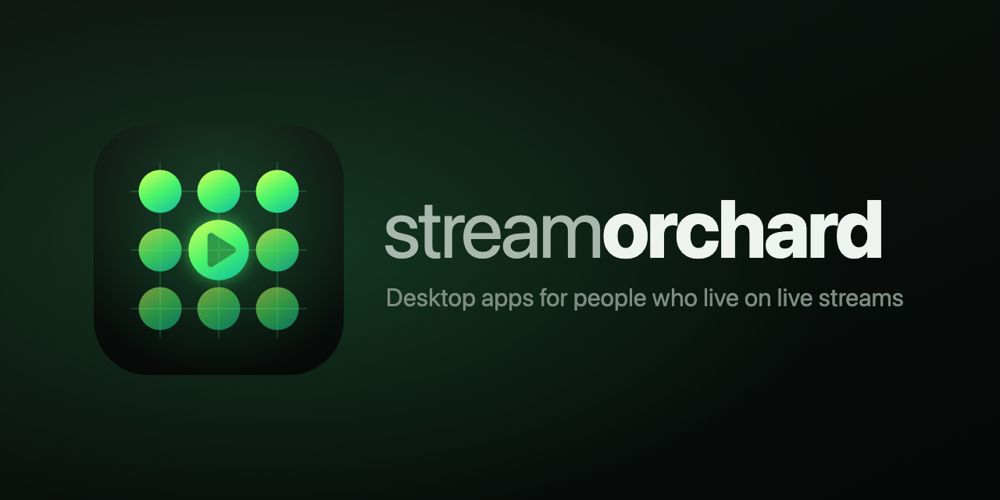
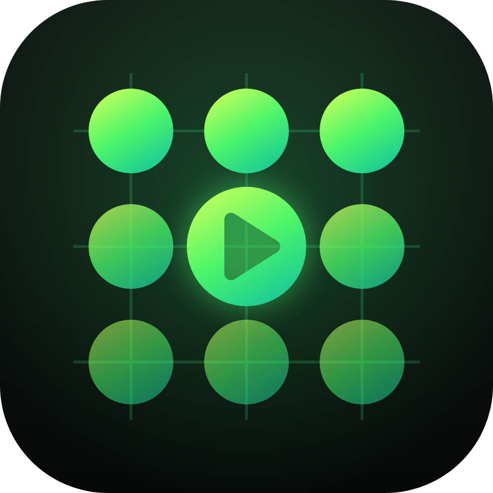

# StreamOrchard brand

The logo, banner and wording for the **StreamOrchard** GitHub organization, home of **Stream Multiview** and **Pear Drops**.

---

## The logo

An orchard seen from above: three rows of trees planted on a grid.

- **The grid** is a multiview: streams tiled side by side, and the neon grid from Tron.
- **The middle tree is playing**: one stream has the focus while the rest keep growing.
- **The rows fade** from front to back, like an orchard going off into the distance.

It's still clear at 20px, so it works as an avatar, a favicon and an app badge.

## Files

| File | Use |
| --- | --- |
| `logo.svg` | The logo, for anything that can show SVG |
| `logo.png` | 1024×1024, for the GitHub org avatar and anywhere that needs a PNG |
| `banner.svg` | The logo with the name and tagline |
| `banner.png` | 1280×640, for a repo's social preview (Settings → Social preview) |
| `logo-square.svg`, `logo-square.png` | The logo with square corners, for places that round or crop it themselves (avatars, app icons) |
| `banner-square.svg`, `banner-square.png` | The banner with the square-cornered logo |
| `concepts/` | The logos that weren't picked, including the earlier pear ones in `concepts/pear/` |

## Colors

| | Hex | Used for |
| --- | --- | --- |
| Lime | `#c4ff5c` | Top of the tree gradient |
| Green | `#4cf56a` | Middle of the gradient, glow |
| Teal | `#14c79a` | Bottom of the gradient |
| Grid | `#3dff8a` | Grid lines and background glow (at low opacity) |
| Night | `#121a15` → `#060908` | Background |
| Text | `#eef3ef` / `#a9b8ae` / `#7d8c83` | Name, the "stream" half of the name, tagline |

The colors aren't any single platform's, so the brand doesn't belong to Kick, Twitch or YouTube.

## Name

Write it as **StreamOrchard** in text. The GitHub org is github.com/StreamOrchard and the npm org is streamorchard. In the logo it's lowercase, with **stream** in a regular weight and **orchard** in bold.

## Wording

**Tagline:** Desktop apps for people who live on live streams

**GitHub description** (160 characters at most):

> Desktop apps for people who live on live streams. Home of Stream Multiview and Pear Drops.

**Profile README** (`StreamOrchard/.github/profile/README.md`):

> **StreamOrchard** makes desktop apps for people who watch a lot of live streams. **Stream Multiview** puts streams and chats from Kick, Twitch and YouTube side by side, in any layout you want. **Pear Drops** runs the real player in the background and collects your drops while you watch something else. Both apps run on Windows, macOS and Linux.

## Making the PNGs

The PNGs are rendered from the SVGs. After changing an SVG, render it again at the same size: open it in a browser at 1024×1024 (1280×640 for the banner) and take a screenshot with a transparent background, or use any SVG-to-PNG tool.
